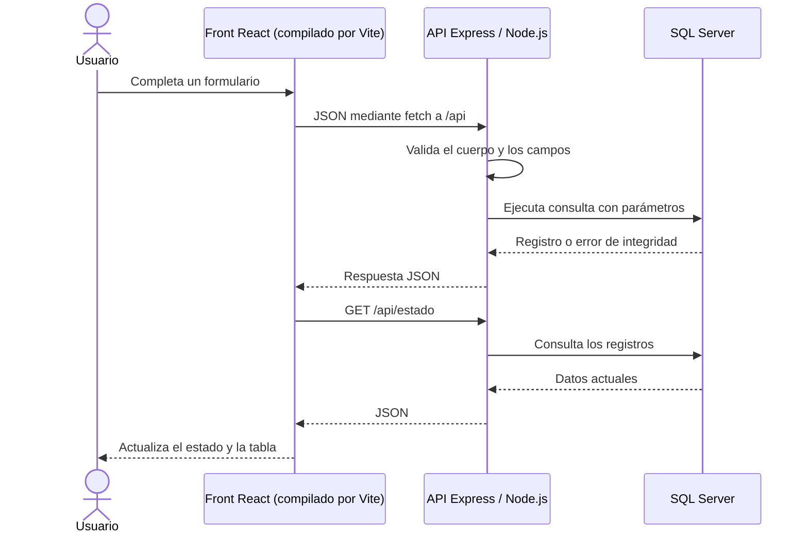

# Guía de Arena

## Tecnologías y arquitectura

El proyecto utiliza el stack acordado: **React + Vite** en el frontend, **Node.js + Express** en el backend y **SQL Server / T-SQL** para la persistencia.

```text
front/
  index.html            Entrada de Vite con el contenedor React
  package.json          Dependencias React/React DOM y herramientas Vite
  package-lock.json     Versiones reproducibles del frontend
  vite.config.js        Plugin React y proxy de desarrollo hacia Express
  styles.css            Diseño de la plataforma
  public/favicon.svg    Recurso público
  src/main.jsx          Montaje con createRoot
  src/App.jsx           Aplicación, navegación, contexto y carga de datos
  src/pages.jsx         Pantallas de equipos, jugadores, torneos y resultados
  src/components.jsx    Formularios, tablas, selectores y controles reutilizables
  src/context.js        Contexto React compartido
  src/api.js            Peticiones HTTP a Express
  dist/                 Resultado de npm run build; se puede regenerar
backend/
  package.json          Dependencias y comandos del backend
  package-lock.json     Versiones reproducibles del backend
  app.js                Express, Router, JSON, archivos estáticos y errores
  server.js             Inicio del servidor local y conexión al motor
  api.js                Operaciones de la plataforma
  db.js                 Consultas SQL parametrizadas y transacciones
  config.js             Configuración de conexión
  validation.js         Validación y mensajes de error
  install-db.js         Instalación desde el script SQL
  .env.example          Configuración de ejemplo
  test/                 Pruebas HTTP, de validación e integración
```



React controla las pantallas y los formularios mediante componentes, hooks y contexto; no se monta la interfaz concatenando HTML. Vite transforma JSX y genera `front/dist`. Express usa un Router para `/api`, `express.json` para recibir formularios y `express.static` para entregar el front compilado. Las consultas existentes siguen usando `mssql` con `msnodesqlv8` y autenticación Windows. Las operaciones compuestas mantienen sus transacciones.

Referencias: [React](https://react.dev/learn), [Vite y React](https://vite.dev/guide/), [archivos estáticos en Express](https://expressjs.com/en/5x/starter/static-files/) y [controlador SQL de Node.js](https://github.com/tediousjs/node-mssql#msnodesqlv8).

## Iniciar la aplicación

1. Abre **iniciar.cmd** con doble clic.
2. Instala automáticamente las dependencias que falten en `backend` y `front`. La primera vez requiere Internet.
3. Compila la interfaz React con Vite.
4. Cuando diga **Aplicación lista**, abre **http://127.0.0.1:3000**.
5. Mantén esa ventana abierta mientras usas la web. Ctrl+C detiene el servidor.

Para uso habitual se necesita un solo servidor en ejecución: Express entrega el build de React y la API en el mismo puerto. No abras `front/index.html` como archivo local. Los datos quedan guardados en SQL Server al cerrar el navegador. SSMS puede estar cerrado, pero el servicio SQL Server debe seguir activo.

## Preparar otro computador

Requisitos: **Windows x64**, **Node.js 24 o superior x64**, **SQL Server 2017 o superior** (Express sirve) y **Microsoft ODBC Driver 18 x64**. Se verificó localmente con SQL Server 2025 Express. El backend usa `STRING_AGG`, por lo que SQL Server 2016 no basta.

Descargas oficiales: [Node.js](https://nodejs.org/en/download), [SQL Server](https://www.microsoft.com/es-es/sql-server/sql-server-downloads), [ODBC Driver 18](https://learn.microsoft.com/en-us/sql/connect/odbc/download-odbc-driver-for-sql-server). Instalar SSMS por sí solo no sustituye la instalación del motor SQL Server.

1. Copia o comprime la carpeta. Puedes excluir `backend/node_modules`, `front/node_modules`, `front/dist`, archivos `.env`, logs y `.git`. Conserva ambos `package.json`, ambos `package-lock.json` y `.env.example`.
2. Instala los requisitos y comprueba que SQL Server esté en ejecución. La cuenta Windows que ejecuta el proyecto necesita permisos en SQL Server para crear y administrar esta base.
3. Si su instancia se llama diferente de `SQLEXPRESS`, copia `backend/.env.example` como `backend/.env` y ajusta `DB_SERVER`.
4. Ejecuta **instalar_base.cmd**. Prepara la base sin participantes ni torneos de ejemplo. No instala SQL Server, Node.js u ODBC; deben estar instalados previamente. No requiere `sqlcmd`.
5. Espera **Base preparada**. Si hay un error, corrige la conexión o los permisos indicados. Ser administrador de Windows no otorga automáticamente permisos de administrador en SQL Server.
6. Ejecuta **iniciar.cmd** y abre la URL mostrada.

Cada equipo usa su propia base. Los datos de las pruebas de tus compañeros no modifican los tuyos. Copiar el proyecto no transporta la base ya instalada ni sincroniza cambios. Trabajar todos sobre los mismos datos requiere un servidor compartido; esta versión está configurada para uso local.

Si la base del proyecto ya existe, el instalador conserva sus registros y redefine procedimientos, vistas y triggers. No es un migrador para estructuras arbitrarias. Como alternativa puedes ejecutar `01_crear_base_datos.sql` completo desde SSMS. No se cargan ejemplos.

## Ingresar y modificar datos

1. **Equipos:** nombre único, categoría y videojuego.
2. **Jugadores:** primer nombre, apellido y alias. Selecciona equipo y un cupo libre del 1 al 5, o deja sin equipo. **Editar / transferir** corrige sus datos o su equipo.
3. **Torneos:** nombre, juego y fechas. Se crean con inscripciones abiertas. Para cambiar estado, elige el estado y pulsa **Aplicar**.
4. **Inscripciones:** selecciona torneo y equipo. Solo se ofrecen equipos activos del mismo juego, con jugadores y sin inscripción previa.
5. **Partidas:** elige torneo, fecha, hora y equipos inscritos. Los juegos con KDA requieren exactamente dos equipos; las carreras admiten dos o más. La alineación se guarda al crear la partida; **Ver alineación** permite consultarla.
6. **Resultados:** marca la partida como **Finalizada**, pulsa **Aplicar** y abre Resultados. Selecciona partida y jugador e ingresa KDA o los datos de carrera.
7. Para corregir resultados, selecciona la misma partida y jugador. Los datos guardados se cargan en los campos y **Guardar resultado** los actualiza.

**Retirar** un equipo lo inactiva y retira sus inscripciones conservando el historial. Una inscripción también puede retirarse de forma individual. El nombre y apellido juntos deben ser únicos según la regla académica solicitada, así como el alias y el nombre del equipo. El front muestra los errores de la API y SQL Server conserva sus restricciones.

Los catálogos disponibles son Shooter, MOBA y Conducción, y Valorant, League of Legends, Counter-Strike y Assetto Corsa. La migración de tecnologías no agrega datos ficticios ni elimina registros que hayas ingresado.

## Configuración

La configuración predeterminada funciona con la instancia local de este computador. Para cambiarla, copia `backend/.env.example` como `backend/.env`:

```ini
PORT=3000
DB_SERVER=lpc:.\SQLEXPRESS
DB_NAME=PlataformaTorneosVideojuegos
DB_DRIVER=ODBC Driver 18 for SQL Server
```

`lpc:` usa memoria compartida local. Para una instancia predeterminada sin nombre usa `DB_SERVER=lpc:.`; para otra instancia, `DB_SERVER=lpc:.\OTRA_INSTANCIA`. Conserva el nombre de la base al utilizar el instalador.

Express escucha en `127.0.0.1` y utiliza la cuenta Windows que inicia el proceso. La aplicación es un panel de administración local y no incorpora cuentas o contraseñas web. No está publicada en Internet. Si cambias `PORT`, abre la nueva dirección.

## Desarrollar con Vite

Instala las dependencias en cada carpeta una vez con `npm ci`. Para trabajar con la recarga de React, abre dos terminales:

```powershell
# Terminal 1, dentro de backend
npm start
```

```powershell
# Terminal 2, dentro de front
npm run dev
```

Abre **http://127.0.0.1:5173**. Vite sirve el código de React y reenvía `/api` al backend del puerto configurado en `backend/.env` (3000 por defecto). El puerto 5173 está fijado para que no cambie silenciosamente. No agregues secretos ni credenciales del motor al frontend.

Para generar la versión que entrega Express:

```powershell
# Dentro de front
npm run build
```

Luego Express sirve `front/dist` en el puerto 3000. `iniciar.cmd` realiza esa compilación cada vez que arranca para incorporar tus cambios. Si aparece `EADDRINUSE`, ya hay otro servidor ocupando ese puerto: usa la ejecución existente o deténla antes de iniciar otra.

## API

Las escrituras usan JSON y los errores responden con `{ "error": "mensaje" }`. Se conserva la API de la versión anterior.

| Método | Ruta | Operación |
| --- | --- | --- |
| GET | `/api/salud` | Comprueba la conexión SQL. |
| GET | `/api/estado` | Catálogos y registros de la interfaz. |
| POST | `/api/equipos` | Crea equipo: nombre, videojuegoId. |
| PUT | `/api/equipos/:id` | Corrige el nombre. |
| POST | `/api/equipos/:id/retirar` | Inactiva equipo y retira inscripciones. |
| POST | `/api/jugadores` | Crea jugador: primerNombre, apellido, alias, equipoId, cupo. |
| PUT | `/api/jugadores/:id` | Corrige o transfiere al jugador. |
| POST | `/api/torneos` | Crea torneo: nombre, videojuegoId, fechaInicio, fechaFin. |
| PATCH | `/api/torneos/:id/estado` | Cambia el estado. |
| POST | `/api/inscripciones` | Inscribe: torneoId, equipoId. |
| PATCH | `/api/inscripciones/retirar` | Retira una inscripción. |
| POST | `/api/partidas` | Crea partida y alineación: torneoId, nombre, fechaHora, equipoIds. |
| PATCH | `/api/partidas/:id/estado` | Cambia el estado. |
| PUT | `/api/resultados/kda` | Crea o corrige KDA por partida y jugador. |
| PUT | `/api/resultados/carrera` | Crea o corrige posición, tiempo en milisegundos y vueltas. |

## Pruebas

Primero compila el front con `npm run build` dentro de `front`. Después, dentro de `backend`, ejecuta `npm test` para las pruebas de Express, compilación servida, límites de JSON, validación e instalador. Las pruebas HTTP necesitan acceso local de red.

Para incluir el recorrido completo con SQL Server:

```powershell
$env:RUN_INTEGRATION='1'
npm test
```

Estas pruebas crean registros con nombres únicos y eliminan solamente sus propios IDs al terminar. No limpian registros del usuario. Comprueban equipos, cupos, inscripciones, alineaciones, estadísticas, transferencias, carreras e historial. SQL Server puede consumir IDs durante las pruebas, por lo que pueden aparecer saltos en la numeración.

La versión React + Vite + Express pasó 14 pruebas automatizadas con el motor real el 30 de octubre de 2026. La interfaz también se revisa desde el navegador.
