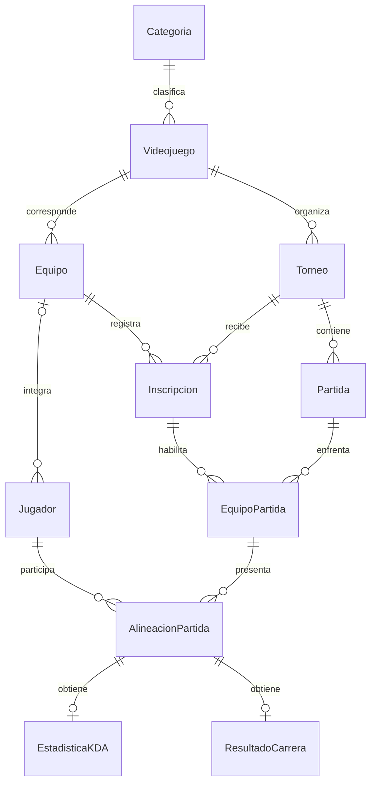

# Modelo relacional

## Entidades y relaciones

Cada equipo admite de cero a cinco jugadores actuales. La notación del diagrama no expresa ese límite: está implementado con los cupos 1–5 y el índice único.

## Diccionario resumido

| Tabla | Clave primaria | Datos y propósito |
| --- | --- | --- |
| Categoria | CategoriaId | Nombre único de categoría. |
| Videojuego | VideojuegoId | Nombre único, categoría y tipo de estadística: KDA o CARRERA. |
| Equipo | EquipoId | Nombre único, juego, activo y fecha de creación. |
| Jugador | JugadorId | Primer nombre, apellido, alias, equipo actual opcional y cupo opcional. Nombre/apellido y alias únicos. |
| Torneo | TorneoId | Juego, nombre, fechas y estado. Nombre único dentro de cada juego. |
| Inscripcion | TorneoId + EquipoId | Relación muchos a muchos entre equipos y torneos. Incluye juego para garantizar compatibilidad mediante claves compuestas, fecha y estado. |
| Partida | PartidaId | Torneo, nombre, fecha/hora y estado. |
| EquipoPartida | PartidaId + EquipoId | Equipos que participaron en una partida; deben estar inscritos en su torneo. Incluye TorneoId como parte de las claves foráneas de validación. |
| AlineacionPartida | PartidaId + JugadorId | Equipo y cupo del jugador en esa partida. Conserva la asociación histórica, con máximo cinco jugadores por equipo y partida. |
| EstadisticaKDA | PartidaId + JugadorId | Asesinatos, muertes, asistencias, KDA calculado, fecha y usuario de registro. |
| ResultadoCarrera | PartidaId + JugadorId | Posición, tiempo en milisegundos, vueltas, fecha y usuario de registro. |

Las claves externas no usan borrado en cascada. Si se intenta borrar un jugador o equipo con dependencias, SQL Server lo bloquea para conservar la información.

## Cómo defender el diseño en clase

**Equipo y torneo son muchos a muchos.** Un equipo participa en varios torneos y un torneo recibe varios equipos. `Inscripcion` resuelve esta relación.

**El equipo actual y el equipo de una partida son hechos distintos.** `Jugador.EquipoId` indica su pertenencia actual. `AlineacionPartida.EquipoId` indica a quién representó en una partida. Transferirlo no altera partidas anteriores.

**Cinco cupos garantizan el límite.** Cada jugador de un equipo ocupa un número entre 1 y 5. El índice único `(EquipoId, Cupo)` evita ocupar dos veces un número. Un sexto integrante no dispone de cupo válido. No es necesario un trigger de conteo.

**Hay integridad entre videojuegos.** `Inscripcion` referencia simultáneamente `(TorneoId, VideojuegoId)` y `(EquipoId, VideojuegoId)`. Ambos deben tener el mismo juego. `EquipoPartida` conecta la partida con una inscripción de su mismo torneo.

**Se separan las estadísticas por tipo.** Las carreras no necesitan columnas de asesinatos y los shooters no necesitan tiempos de vueltas. Los triggers verifican que cada tabla de resultados se utilice en su tipo de juego y después de terminar la partida.

**Las vistas proporcionan los apartados por juego.** `vw_TorneosValorant`, `vw_TorneosLoL`, `vw_TorneosCounterStrike` y `vw_TorneosAssettoCorsa` consultan el mismo modelo y muestran solo sus torneos.

**Retirar no borra la historia.** `usp_RetirarEquipo` marca el equipo como inactivo y sus inscripciones como retiradas, manteniendo jugadores y resultados. Una corrección del jugador se hace mediante `UPDATE` o una transferencia mediante `usp_AsignarJugador`.

**Los permisos se asignan con SQL Server.** El rol `AdministradorTorneos` tiene control de esta base y el usuario demostrativo `AdminProyecto` pertenece al rol. El nombre de una tabla o una columna que diga administrador no otorgaría permisos por sí mismo.
